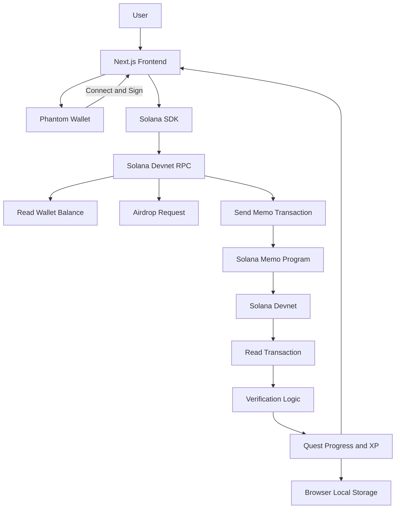

# Product Requirements Document (PRD)

# SolTrail

**Tagline:** Learn Solana by Doing  
**Versi:** 1.0  
**Tanggal:** 8 November 2026  
**Status:** Draft untuk Hackathon MVP  
**Target kategori:** Best Beginner Hack  
**Platform:** Web application

---

## 1. Ringkasan Produk

SolTrail adalah platform pembelajaran interaktif yang membantu pemula mengenal ekosistem Solana melalui misi praktik langsung (*learning quests*). Pengguna tidak hanya membaca dokumentasi, tetapi melakukan aktivitas sederhana menggunakan wallet dan Solana Devnet.

Setiap misi memiliki instruksi, tindakan yang harus dilakukan, dan kriteria penyelesaian. Sistem memeriksa data wallet atau transaksi melalui Solana RPC sebelum memberikan status selesai. Dengan pendekatan ini, progres belajar didasarkan pada aktivitas yang dapat diverifikasi, bukan sekadar tombol **Complete**.

### 1.1 Masalah

Pemula yang ingin mempelajari Solana sering menghadapi beberapa kendala:

- Istilah seperti wallet address, SOL, transaction signature, dan program masih sulit dipahami.
- Tutorial sering berfokus pada dokumentasi atau kode, sehingga pemula belum tentu mendapatkan pengalaman praktik.
- Pengguna belum mengetahui cara membaca saldo dan memeriksa transaksi di blockchain.
- Tidak ada alur belajar singkat yang mengarahkan pemula dari menghubungkan wallet hingga melakukan dan memverifikasi transaksi pertama.

### 1.2 Solusi

SolTrail menyediakan jalur belajar bertahap melalui lima misi. Pengguna menghubungkan Phantom Wallet, membaca informasi wallet, memperoleh SOL Devnet, mengirim pesan on-chain melalui Memo Program, lalu memverifikasi transaksi tersebut.

### 1.3 Nilai Utama

**Learn by doing, prove it on-chain.** Pengguna mempelajari konsep dasar Solana dengan melakukan aktivitas nyata di Devnet. Penyelesaian misi transaksi diverifikasi menggunakan data blockchain.

---

## 2. Tujuan dan Indikator Keberhasilan

### 2.1 Tujuan Produk

1. Membantu pengguna baru memahami alur dasar penggunaan Solana.
2. Memberikan pengalaman praktik blockchain melalui wallet dan transaksi Devnet.
3. Menjelaskan aktivitas teknis dengan bahasa sederhana.
4. Menampilkan progres belajar yang didukung oleh bukti aktivitas blockchain.
5. Menghasilkan MVP yang dapat didemonstrasikan secara end-to-end dalam hackathon.

### 2.2 Indikator Keberhasilan MVP

MVP dianggap berhasil apabila:

- Pengguna dapat menghubungkan dan memutuskan koneksi Phantom Wallet.
- Aplikasi dapat membaca dan menampilkan alamat wallet serta saldo SOL Devnet.
- Pengguna dapat mengikuti seluruh lima misi.
- Pengguna dapat memperoleh SOL Devnet atau mengikuti petunjuk faucet yang disediakan.
- Pengguna dapat mengirim transaksi berisi Memo melalui wallet.
- Aplikasi dapat memverifikasi signature, status transaksi, signer, dan isi Memo melalui Solana RPC.
- Progres dan XP tersimpan di browser untuk wallet yang digunakan.
- Pengguna dapat membuka transaksi yang berhasil di Solana Explorer.

### 2.3 Bukan Target MVP

- Mengajarkan seluruh konsep Solana, DeFi, NFT, atau smart contract.
- Mendukung jaringan Solana Mainnet.
- Mengelola atau menyimpan private key maupun recovery phrase.
- Menerbitkan NFT atau token untuk achievement.
- Membuat smart contract khusus menggunakan Anchor atau Rust.
- Menyediakan leaderboard lintas pengguna.
- Menyediakan akun pengguna, autentikasi email, atau backend khusus.

---

## 3. Target Pengguna

### 3.1 Pengguna Utama

Pemula yang tertarik mempelajari Solana dan sudah memiliki atau bersedia memasang wallet yang kompatibel, seperti Phantom.

### 3.2 Karakteristik Pengguna

- Belum memahami seluruh istilah dan mekanisme transaksi Solana.
- Membutuhkan panduan langkah demi langkah.
- Lebih mudah belajar melalui praktik daripada dokumentasi panjang.
- Memerlukan lingkungan uji coba yang tidak menggunakan aset bernilai nyata.

### 3.3 Kebutuhan Pengguna

Sebagai pengguna baru, saya ingin menghubungkan wallet dan melihat saldo agar memahami identitas serta aset pada wallet Solana.

Sebagai pengguna baru, saya ingin memperoleh SOL Devnet agar dapat mencoba transaksi tanpa menggunakan SOL Mainnet.

Sebagai pengguna baru, saya ingin mengirim pesan sederhana ke blockchain dan melihat buktinya agar memahami bagaimana transaksi Solana bekerja.

---

## 4. Ruang Lingkup MVP

MVP terdiri dari empat bagian utama:

1. **Wallet connection** — menghubungkan Phantom Wallet dan membaca informasi wallet.
2. **Learning quests** — menyediakan lima misi belajar yang berurutan.
3. **On-chain interaction** — mengirim Memo transaction pada Solana Devnet.
4. **Transaction verification** — membaca transaksi dari RPC dan memperbarui progres berdasarkan hasil pemeriksaan.

Semua interaksi blockchain MVP hanya menggunakan **Solana Devnet**. Aplikasi harus menampilkan indikator jaringan secara jelas agar pengguna tidak salah mengira bahwa mereka sedang menggunakan Mainnet.

---

## 5. Alur Pengguna

1. Pengguna membuka halaman utama SolTrail.
2. Pengguna membaca penjelasan singkat dan menekan **Start Learning**.
3. Pengguna menghubungkan Phantom Wallet.
4. Aplikasi memastikan koneksi mengarah ke Solana Devnet.
5. Pengguna masuk ke dashboard dan melihat alamat serta saldo wallet.
6. Pengguna menyelesaikan misi secara berurutan.
7. Pada misi transaksi, pengguna meninjau pesan Memo dan menyetujui transaksi melalui Phantom.
8. Aplikasi mengirim transaksi ke Devnet dan memperoleh transaction signature.
9. Aplikasi membaca transaksi melalui Solana RPC dan memeriksa bukti yang dibutuhkan.
10. Jika seluruh pemeriksaan berhasil, misi ditandai selesai dan XP diberikan.
11. Pengguna melihat ringkasan pencapaian dan tautan transaksi di Solana Explorer.

---

## 6. Rincian Learning Quests

Setiap misi memiliki judul, deskripsi, tujuan belajar, instruksi, status, dan XP. Pengguna dapat melihat misi yang terkunci serta prasyarat penyelesaiannya.

| ID | Misi | Aktivitas | Kriteria penyelesaian | XP |
|---|---|---|---|---:|
| Q01 | Connect Wallet | Menghubungkan Phantom Wallet | Wallet berhasil terhubung dan public key tersedia | 50 |
| Q02 | Explore Your Wallet | Membaca alamat dan saldo wallet | Alamat valid berhasil dibaca dan saldo berhasil diperoleh dari Devnet RPC | 100 |
| Q03 | Get Your First SOL | Meminta SOL Devnet atau menggunakan faucet | Saldo Devnet bertambah dan perubahan saldo terdeteksi, atau bukti airdrop berhasil diperoleh | 100 |
| Q04 | First On-chain Message | Mengirim transaksi dengan Memo Program | Transaksi berhasil dikonfirmasi dan signer sesuai dengan wallet pengguna | 200 |
| Q05 | Verify Your Transaction | Memeriksa transaksi melalui aplikasi | Signature ditemukan, transaksi sukses, signer benar, dan isi Memo sesuai dengan misi | 200 |

**Total XP:** 650 XP.

### 6.1 Q01 — Connect Wallet

**Tujuan:** Memahami fungsi wallet sebagai identitas pengguna untuk berinteraksi dengan Solana.

**Langkah:**

1. Pengguna menekan tombol **Connect Wallet**.
2. Pengguna memilih Phantom jika tersedia.
3. Pengguna menyetujui koneksi dari aplikasi wallet.
4. Aplikasi membaca public key dan menampilkan alamat yang sudah disingkat.

**Aturan:**

- Jangan meminta private key atau recovery phrase.
- Jika wallet belum tersedia, tampilkan petunjuk pemasangan wallet.
- Misi hanya selesai setelah aplikasi menerima public key yang valid.

### 6.2 Q02 — Explore Your Wallet

**Tujuan:** Memahami wallet address dan saldo SOL.

**Langkah:**

1. Aplikasi membaca public key dari wallet yang terhubung.
2. Aplikasi meminta saldo melalui Solana Devnet RPC.
3. Saldo ditampilkan dalam satuan SOL.
4. Pengguna melihat penjelasan singkat tentang address, SOL, dan lamports.

**Kriteria:**

- Public key tersedia.
- Pembacaan saldo berhasil.
- Jaringan yang digunakan adalah Devnet.

### 6.3 Q03 — Get Your First SOL

**Tujuan:** Memahami bahwa Devnet menyediakan SOL uji coba untuk pengembangan.

**Langkah:**

1. Aplikasi menampilkan alamat wallet pengguna.
2. Pengguna menekan **Get Devnet SOL**.
3. Aplikasi membuka faucet resmi atau menjalankan permintaan airdrop melalui RPC jika tersedia.
4. Setelah proses selesai, pengguna menekan **Refresh Balance**.
5. Aplikasi membandingkan saldo dengan saldo awal yang dicatat saat misi dimulai.

**Kriteria:**

- Saldo Devnet bertambah dibandingkan saldo awal, atau request airdrop mendapatkan signature yang berhasil dikonfirmasi.
- Jika faucet atau RPC mengalami pembatasan, aplikasi menampilkan pesan dan menyediakan tautan faucet sebagai alternatif.

**Catatan:** Ketersediaan airdrop bergantung pada layanan Devnet dan batas permintaan jaringan. Kegagalan faucet tidak boleh membuat aplikasi macet.

### 6.4 Q04 — First On-chain Message

**Tujuan:** Memahami proses pembuatan, penandatanganan, dan pengiriman transaksi.

**Langkah:**

1. Aplikasi membuat pesan Memo dengan format unik, misalnya:

   `SOLTRAIL|QUEST=HELLO_SOLANA|ID=<unique-id>`

2. Aplikasi membuat transaksi yang memuat instruksi Memo Program.
3. Aplikasi menampilkan ringkasan transaksi dan jaringan Devnet.
4. Pengguna menandatangani transaksi melalui Phantom.
5. Aplikasi mengirim transaksi dan menunggu konfirmasi.
6. Aplikasi menyimpan transaction signature untuk proses verifikasi.

**Kriteria:**

- Transaksi dikirim ke Devnet.
- Transaksi memperoleh signature.
- Transaksi berhasil dikonfirmasi tanpa error.
- Wallet yang terhubung merupakan signer transaksi.

**Aturan UX dan keamanan:**

- Tampilkan bahwa transaksi membutuhkan SOL Devnet untuk biaya jaringan.
- Tampilkan pesan Memo sebelum pengguna menyetujui transaksi.
- Jangan mengirim transaksi tanpa persetujuan eksplisit dari wallet.
- Sediakan status `Preparing`, `Waiting for Wallet`, `Sending`, `Confirming`, `Success`, dan `Failed`.

### 6.5 Q05 — Verify Your Transaction

**Tujuan:** Memahami transaction signature dan cara memeriksa bukti transaksi.

**Langkah:**

1. Aplikasi mengambil transaksi berdasarkan signature.
2. Aplikasi memeriksa status transaksi.
3. Aplikasi memeriksa signer dan instruksi Memo.
4. Jika valid, aplikasi menandai misi selesai.
5. Pengguna dapat membuka transaksi melalui Solana Explorer pada jaringan Devnet.

**Kriteria verifikasi minimum:**

- Transaksi ditemukan pada Devnet.
- Transaksi telah mencapai status konfirmasi yang disyaratkan aplikasi.
- `meta.err` bernilai `null`.
- Public key signer sesuai dengan wallet pengguna.
- Instruksi Memo berasal dari Memo Program yang digunakan aplikasi.
- Isi Memo memuat penanda misi dan ID unik yang dibuat aplikasi.

**Catatan:** Misi Q05 merupakan langkah verifikasi yang terpisah secara edukatif, tetapi menggunakan bukti transaksi yang dibuat pada Q04. Pengguna tidak perlu mengirim transaksi kedua.

---

## 7. Persyaratan Fungsional

Prioritas:

- **P0:** Wajib tersedia untuk MVP.
- **P1:** Dikerjakan setelah seluruh alur P0 berjalan.
- **P2:** Pengembangan lanjutan jika waktu memungkinkan.

| ID | Fitur | Persyaratan | Prioritas |
|---|---|---|---|
| FR-01 | Connect wallet | Pengguna dapat menghubungkan Phantom Wallet | P0 |
| FR-02 | Disconnect wallet | Pengguna dapat memutuskan koneksi wallet | P0 |
| FR-03 | Network indicator | Aplikasi menampilkan jaringan Devnet yang sedang digunakan | P0 |
| FR-04 | Wallet overview | Aplikasi menampilkan public key dan saldo SOL | P0 |
| FR-05 | Quest catalog | Aplikasi menampilkan lima misi, status, deskripsi, dan XP | P0 |
| FR-06 | Quest prerequisite | Misi tertentu hanya dapat diselesaikan setelah prasyarat terpenuhi | P0 |
| FR-07 | Devnet SOL | Pengguna dapat membuka faucet atau meminta airdrop dan memperbarui saldo | P0 |
| FR-08 | Memo transaction | Pengguna dapat membuat dan menyetujui transaksi Memo melalui wallet | P0 |
| FR-09 | Transaction verification | Aplikasi memverifikasi signature, status, signer, dan Memo melalui RPC | P0 |
| FR-10 | Progress tracking | Aplikasi menyimpan status misi dan XP per wallet di browser | P0 |
| FR-11 | Achievement | Aplikasi menampilkan badge lokal setelah seluruh misi selesai | P1 |
| FR-12 | Proof card | Aplikasi menampilkan signature, jaringan, waktu, dan Explorer link | P1 |
| FR-13 | Retry handling | Pengguna dapat mencoba kembali proses yang gagal tanpa merusak progres sebelumnya | P1 |
| FR-14 | Learning glossary | Aplikasi menyediakan penjelasan istilah dasar Solana | P2 |

---

## 8. Persyaratan Nonfungsional

### 8.1 Keamanan

- Aplikasi tidak boleh meminta, menerima, atau menyimpan private key dan recovery phrase.
- Penandatanganan transaksi harus dilakukan melalui wallet pengguna.
- Aplikasi hanya menggunakan Devnet untuk MVP.
- Pesan Memo harus ditampilkan sebelum transaksi ditandatangani.
- Jangan menaruh data pribadi atau rahasia di dalam Memo karena data on-chain bersifat publik.
- Jangan menganggap status transaksi berhasil hanya berdasarkan signature. Status harus diperiksa melalui RPC.
- Jangan mempercayai status progres dari localStorage sebagai bukti transaksi. Untuk misi on-chain, lakukan verifikasi ulang terhadap blockchain.

### 8.2 Performa dan Reliabilitas

- Tampilan utama harus dapat digunakan pada desktop dan perangkat mobile.
- Aplikasi menampilkan loading state saat mengambil data RPC.
- Kegagalan RPC, wallet tidak tersedia, dan transaksi gagal harus menghasilkan pesan yang dapat dipahami.
- Pengguna dapat mengulang permintaan data tanpa harus menghubungkan wallet dari awal.
- Aplikasi tidak boleh mengunci UI ketika menunggu konfirmasi transaksi.

### 8.3 Kompatibilitas

- Browser modern berbasis Chromium, Firefox, dan Safari versi terbaru.
- Phantom Wallet pada browser yang didukung.
- Layout responsif untuk desktop dan mobile.

### 8.4 Aksesibilitas dan Kemudahan Penggunaan

- Gunakan bahasa sederhana dan jelaskan istilah teknis saat pertama kali muncul.
- Tombol utama harus memiliki label tindakan yang jelas.
- Status transaksi tidak boleh hanya dibedakan melalui warna.
- Kontras teks dan latar harus memadai.

---

## 9. Struktur Halaman dan Navigasi

### 9.1 Landing Page — `/`

Komponen:

- Logo dan nama SolTrail.
- Tagline: **Learn Solana by Doing**.
- Penjelasan singkat manfaat produk.
- Tombol **Start Learning**.
- Penjelasan bahwa aplikasi menggunakan Solana Devnet.

### 9.2 Learning Dashboard — `/learn`

Komponen:

- Status koneksi wallet.
- Network indicator: Solana Devnet.
- Wallet address.
- Saldo SOL.
- Total XP dan persentase progres.
- Daftar lima quest.
- Status setiap quest: `Locked`, `Available`, `In Progress`, atau `Completed`.

### 9.3 Quest Detail

Dapat ditampilkan sebagai halaman atau panel pada dashboard.

Komponen:

- Judul dan tujuan misi.
- Penjelasan konsep.
- Langkah pengerjaan.
- Tombol aksi utama.
- Status proses dan hasil pemeriksaan.
- Tombol untuk mencoba kembali jika gagal.

### 9.4 Proof Page — `/proof/[signature]`

Komponen:

- Status verifikasi.
- Transaction signature.
- Wallet signer.
- Network.
- Isi Memo.
- Waktu transaksi jika tersedia.
- Tautan **View on Solana Explorer**.

Halaman ini hanya menampilkan bukti yang dapat dibaca ulang dari blockchain. Jangan menampilkan bukti sebagai valid sebelum pemeriksaan RPC berhasil.

---

## 10. Arsitektur Teknis

### 10.1 Gambaran Arsitektur



### 10.2 Komponen

| Komponen | Tanggung jawab |
|---|---|
| Next.js UI | Menampilkan halaman, quest, status, dan progres |
| Wallet integration | Menghubungkan Phantom dan meminta tanda tangan transaksi |
| Solana client | Berkomunikasi dengan Solana Devnet RPC |
| Memo transaction module | Membuat instruksi Memo dan mengirim transaksi |
| Verification module | Memeriksa signature, error, signer, dan isi Memo |
| Progress storage | Menyimpan progres dan XP di localStorage |

### 10.3 Pilihan Teknologi

| Bagian | Teknologi |
|---|---|
| Framework | Next.js App Router |
| Bahasa | TypeScript |
| Styling | Tailwind CSS |
| UI components | shadcn/ui |
| Solana SDK | Solana Kit atau SDK resmi yang kompatibel dengan integrasi wallet yang dipilih |
| Wallet | Phantom melalui Wallet Standard atau integrasi wallet Solana yang kompatibel |
| On-chain memo | Solana Memo Program |
| Blockchain network | Solana Devnet |
| Data lokal | localStorage |
| Deployment | Vercel |

**Catatan implementasi:** Tetapkan satu pendekatan SDK dan wallet integration saat bootstrap proyek. Hindari mencampur beberapa library transaksi/wallet tanpa kebutuhan karena dapat menambah kompleksitas dan konflik tipe.

### 10.4 Integrasi RPC yang Dibutuhkan

- `getBalance` untuk membaca saldo wallet.
- `requestAirdrop` jika permintaan airdrop langsung digunakan.
- `getLatestBlockhash` untuk menyiapkan transaksi.
- `sendTransaction` atau metode pengiriman yang sesuai dengan SDK dan wallet integration.
- `getSignatureStatuses` atau mekanisme konfirmasi yang sesuai.
- `getTransaction` untuk membaca detail dan memverifikasi transaksi.

Semua request harus diarahkan ke endpoint Devnet.

---

## 11. Data dan Penyimpanan

MVP tidak membutuhkan database. Data progres disimpan di localStorage dengan wallet address sebagai kunci identitas lokal.

### 11.1 Contoh Struktur Data

```ts
type QuestStatus =
  | "locked"
  | "available"
  | "in_progress"
  | "completed";

type QuestProgress = {
  questId: string;
  status: QuestStatus;
  completedAt?: string;
  transactionSignature?: string;
  xpAwarded: number;
};

type UserProgress = {
  walletAddress: string;
  network: "devnet";
  totalXp: number;
  quests: QuestProgress[];
  updatedAt: string;
};
```

### 11.2 Aturan Penyimpanan

- Simpan progres terpisah untuk setiap wallet address.
- Jangan menyimpan secret key, seed phrase, atau data autentikasi wallet.
- Simpan transaction signature untuk memudahkan verifikasi ulang.
- Cegah XP diberikan lebih dari sekali untuk quest yang sama.
- Jika data localStorage hilang, pengguna dapat mengulang misi. Bukti on-chain tetap dapat diperiksa menggunakan signature yang tersedia.
- Untuk MVP, badge adalah pencapaian visual di aplikasi, bukan NFT atau aset on-chain.

---

## 12. Aturan Bisnis

1. Seluruh aktivitas blockchain MVP wajib berjalan di Solana Devnet.
2. Pengguna harus menghubungkan wallet sebelum menyelesaikan misi yang membutuhkan data wallet.
3. Q02 membutuhkan koneksi wallet dan pembacaan saldo yang berhasil.
4. Q03 memerlukan bukti saldo bertambah atau airdrop berhasil dikonfirmasi.
5. Q04 memerlukan transaksi Memo yang berhasil dikirim dan dikonfirmasi.
6. Q05 memerlukan verifikasi transaksi yang dibuat pada Q04.
7. XP hanya diberikan ketika misi berhasil diverifikasi.
8. XP untuk misi yang sama tidak boleh diberikan berulang kali.
9. Misi yang sudah selesai tidak boleh kembali menjadi belum selesai hanya karena pengguna memuat ulang halaman.
10. Jika pengguna berpindah wallet, aplikasi harus memuat progres yang sesuai dengan wallet tersebut.
11. Jika pengguna berpindah jaringan, aplikasi harus meminta pengguna kembali ke Devnet sebelum menjalankan fitur MVP.
12. SolTrail tidak menjamin bahwa suatu transaksi aman secara finansial. Aplikasi hanya memandu dan memverifikasi aktivitas belajar yang ditentukan.

---

## 13. Penanganan Error dan Edge Cases

| Kondisi | Perilaku aplikasi |
|---|---|
| Phantom tidak terpasang | Tampilkan petunjuk memasang wallet dan tautan resmi Phantom |
| Pengguna menolak koneksi | Tampilkan pesan bahwa koneksi dibatalkan dan sediakan tombol coba lagi |
| Wallet tidak berada di Devnet | Tampilkan instruksi mengganti jaringan ke Devnet dan nonaktifkan aksi transaksi |
| RPC tidak merespons | Tampilkan pesan gangguan jaringan dan tombol retry |
| Faucet mencapai rate limit | Jelaskan pembatasan dan sediakan tautan faucet alternatif/resmi |
| Saldo belum bertambah | Sediakan tombol refresh dan instruksi menunggu konfirmasi |
| Pengguna menolak tanda tangan | Batalkan proses tanpa mengubah status quest menjadi selesai |
| Pengiriman transaksi gagal | Tampilkan pesan error dan izinkan pengguna mencoba kembali |
| Signature belum ditemukan | Ulangi pemeriksaan dengan jeda dan tampilkan status pending |
| Transaksi memiliki error | Jangan berikan XP dan tampilkan bahwa transaksi gagal |
| Signer tidak cocok | Tolak verifikasi dan jangan menyelesaikan quest |
| Memo tidak sesuai | Tolak verifikasi dan jangan menyelesaikan quest |
| Pengguna mengganti wallet | Muat progres berdasarkan wallet baru |
| localStorage tidak tersedia | Tampilkan peringatan bahwa progres lokal mungkin tidak tersimpan |

---

## 14. Desain UI/UX

### 14.1 Arah Visual

- Dark mode sebagai tampilan utama.
- Gaya modern yang terinspirasi dari dashboard developer tools.
- Warna aksen ungu atau hijau kebiruan secukupnya.
- Kartu misi dengan hierarki informasi yang jelas.
- Gunakan ikon untuk membantu mengenali jenis aktivitas.
- Hindari terlalu banyak dekorasi yang mengganggu fokus belajar.

### 14.2 Prinsip UX

- Satu misi memiliki satu tindakan utama.
- Berikan penjelasan singkat sebelum pengguna melakukan transaksi.
- Tampilkan status jaringan dan wallet secara konsisten.
- Berikan umpan balik langsung setelah setiap aksi.
- Jelaskan alasan ketika sebuah misi belum dapat diselesaikan.
- Tampilkan bukti transaksi dan tautan Explorer setelah transaksi berhasil.

### 14.3 Status UI

Status misi:

- `Locked` — prasyarat belum terpenuhi.
- `Available` — misi siap dimulai.
- `In Progress` — pengguna sedang mengerjakan misi.
- `Completed` — kriteria penyelesaian sudah diverifikasi.

Status transaksi:

- `Preparing`
- `Waiting for Wallet`
- `Sending`
- `Confirming`
- `Success`
- `Failed`

---

## 15. Kriteria Penerimaan MVP

MVP dinyatakan siap untuk demo apabila seluruh kriteria P0 berikut terpenuhi:

- [ ] Landing page menampilkan tujuan SolTrail dan tombol mulai.
- [ ] Pengguna dapat menghubungkan Phantom Wallet.
- [ ] Aplikasi menampilkan alamat wallet dan indikator Devnet.
- [ ] Aplikasi berhasil membaca saldo melalui RPC.
- [ ] Pengguna mendapatkan panduan untuk memperoleh SOL Devnet.
- [ ] Aplikasi dapat membuat transaksi Memo dengan ID misi yang unik.
- [ ] Phantom menampilkan permintaan tanda tangan sebelum transaksi dikirim.
- [ ] Transaksi berhasil dikirim dan memperoleh signature.
- [ ] Aplikasi dapat membaca transaksi melalui Devnet RPC.
- [ ] Verifikasi memeriksa status transaksi, signer, dan isi Memo.
- [ ] Misi hanya selesai setelah verifikasi berhasil.
- [ ] XP tidak diberikan dua kali untuk misi yang sama.
- [ ] Progres tetap tersedia setelah halaman dimuat ulang pada browser yang sama.
- [ ] Pengguna dapat membuka transaksi di Solana Explorer Devnet.
- [ ] Aplikasi menampilkan error yang jelas ketika wallet atau RPC gagal.
- [ ] Aplikasi dapat digunakan pada desktop dan mobile.

---

## 16. Prioritas Pengembangan

Urutan implementasi yang disarankan:

### Tahap 1 — Project Setup

- Buat proyek Next.js dengan TypeScript.
- Konfigurasi Tailwind CSS dan shadcn/ui.
- Siapkan environment untuk endpoint Devnet.
- Buat layout dasar dan halaman landing.

### Tahap 2 — Wallet and RPC

- Integrasikan Phantom.
- Buat wallet connection dan disconnect.
- Tampilkan public key.
- Ambil dan tampilkan saldo Devnet.
- Pastikan aplikasi mendeteksi jaringan yang digunakan.

### Tahap 3 — On-chain Transaction

- Buat fungsi untuk menyusun Memo instruction.
- Buat transaksi Devnet.
- Minta persetujuan dan tanda tangan melalui Phantom.
- Kirim transaksi dan dapatkan signature.
- Implementasikan mekanisme konfirmasi.

### Tahap 4 — Verification

- Ambil transaksi berdasarkan signature.
- Validasi error transaksi.
- Validasi signer.
- Validasi Memo Program dan isi Memo.
- Buat hasil verifikasi yang dapat digunakan untuk menyelesaikan quest.

### Tahap 5 — Quest and Progress

- Buat data lima quest.
- Implementasikan prasyarat dan status quest.
- Implementasikan XP dan progress indicator.
- Simpan progres berdasarkan wallet di localStorage.
- Buat achievement badge lokal.

### Tahap 6 — Polish and Submission

- Rapikan tampilan desktop dan mobile.
- Tambahkan loading, success, pending, dan error states.
- Uji alur menggunakan wallet Devnet.
- Deploy ke Vercel.
- Siapkan README, video demo, dan tautan repository.

---

## 17. Risiko dan Mitigasi

| Risiko | Dampak | Mitigasi |
|---|---|---|
| Integrasi wallet memerlukan penyesuaian SDK | Pengembangan tertunda | Gunakan satu pendekatan integrasi dan buat koneksi wallet sebagai proof of concept sejak awal |
| RPC Devnet tidak stabil atau terkena rate limit | Data transaksi lambat atau gagal dibaca | Gunakan retry, tampilkan status pending, dan siapkan endpoint RPC alternatif yang tepercaya |
| Faucet membatasi permintaan | Pengguna tidak memperoleh SOL | Sediakan tautan faucet dan instruksi manual sebagai fallback |
| Transaksi tidak segera terkonfirmasi | Quest tampak tertunda | Poll status dengan jeda dan batas waktu yang wajar |
| Progres localStorage diubah pengguna | Tampilan progres tidak konsisten | Jangan menganggap localStorage sebagai bukti transaksi, verifikasi ulang transaksi on-chain |
| Scope bertambah | MVP tidak selesai tepat waktu | Pertahankan prioritas P0 dan tunda fitur P2 |

---

## 18. Demo Scenario

Skenario demo yang disarankan untuk presentasi hackathon:

1. Buka SolTrail dan jelaskan masalah pembelajaran Solana bagi pemula.
2. Hubungkan Phantom Wallet yang berada di Devnet.
3. Tunjukkan wallet address dan saldo yang dibaca langsung dari RPC.
4. Buka misi Get Your First SOL dan tunjukkan proses memperoleh SOL Devnet.
5. Buka misi First On-chain Message.
6. Tunjukkan isi Memo sebelum meminta tanda tangan.
7. Setujui transaksi melalui Phantom.
8. Tunjukkan status transaksi hingga berhasil dikonfirmasi.
9. Tunjukkan proses verifikasi signer dan isi Memo.
10. Buka tautan Solana Explorer untuk membuktikan transaksi tercatat di Devnet.
11. Tunjukkan quest yang selesai dan XP yang diperoleh.

**Pesan utama demo:** SolTrail membantu pemula belajar Solana dengan melakukan aktivitas nyata dan membuktikan hasilnya melalui blockchain.

---

## 19. Referensi Teknis

Gunakan dokumentasi resmi berikut selama implementasi:

- Solana Documentation: https://solana.com/docs
- Solana Frontend / Next.js: https://solana.com/docs/frontend/nextjs-solana
- Solana RPC `getTransaction`: https://solana.com/docs/rpc/http/gettransaction
- Solana Devnet Faucet: https://faucet.solana.com/
- Solana Explorer: https://explorer.solana.com/?cluster=devnet
- Phantom: https://phantom.com/

---

## 20. Ringkasan Keputusan Produk

| Aspek | Keputusan |
|---|---|
| Nama produk | SolTrail |
| Tagline | Learn Solana by Doing |
| Target pengguna | Pemula Solana |
| Target hackathon | Best Beginner Hack |
| Platform | Web application |
| Framework | Next.js App Router |
| Bahasa pemrograman | TypeScript |
| Blockchain | Solana Devnet |
| Wallet | Phantom |
| Interaksi on-chain | Memo Program |
| Jumlah misi MVP | 5 |
| Total XP | 650 XP |
| Penyimpanan progres | localStorage |
| Backend | Tidak diperlukan untuk MVP |
| Smart contract khusus | Tidak diperlukan untuk MVP |
| Achievement | Badge lokal, bukan NFT |
| Deployment | Vercel |

**Definisi MVP:** SolTrail siap didemonstrasikan ketika seorang pengguna dapat menghubungkan wallet, membaca saldo Devnet, memperoleh SOL uji coba, mengirim Memo transaction, memverifikasi transaksi tersebut melalui RPC, dan mendapatkan progres belajar berdasarkan hasil verifikasi.
